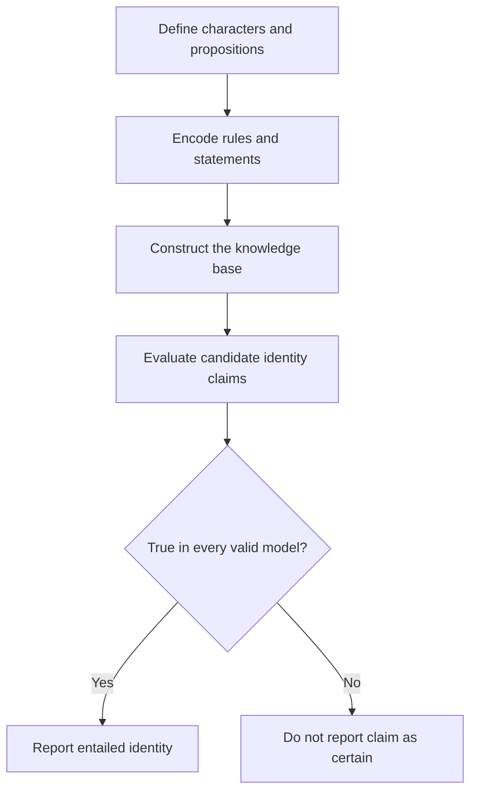

# Knights and Knaves | Propositional Logic & Knowledge Representation

  

> **Project 03 / 12 — Harvard CS50's Introduction to Artificial Intelligence with Python**  
> **Topic:** Knowledge Representation · Propositional Logic · Logical Entailment · Model Checking

## Project Overview

**Knights and Knaves** is a symbolic artificial intelligence project that solves logical puzzles by representing statements as propositional formulas and evaluating what must be true under a consistent set of rules.

Each character belongs to exactly one of two categories:

- **Knight:** always makes true statements.
- **Knave:** always makes false statements.

The challenge is to determine each person's identity from statements made by the characters, including statements about other characters and, in more complex cases, reports of what someone else said.

Unlike a statistical machine-learning model, this program relies on **formal logic and exhaustive model checking** to draw conclusions from a knowledge base.

## Core AI Concepts

| Concept | Role in this project |
|---|---|
| Propositional logic | Represents truth-valued facts and statements |
| Knowledge representation | Encodes puzzle rules as structured logical expressions |
| Logical connectives | Combines statements with NOT, AND, OR, implication, and biconditional |
| Knowledge base | Stores constraints that must all hold simultaneously |
| Model checking | Examines possible truth assignments for logical symbols |
| Entailment | Determines whether a statement follows in every model consistent with the knowledge base |

### Logical entailment

For a knowledge base \(KB\) and proposition \(\alpha\), entailment means:

\[
KB \models \alpha
\]

In this project, `model_check(knowledge, query)` tests whether the query is true in **every** assignment of truth values that satisfies the knowledge base. Assignments that do not satisfy the knowledge base do not refute the query.

### Basic puzzle constraints

For each character, the knowledge base enforces **exactly one** identity: knight or knave. Their statements are then tied to their identity through logical conditions so that truthful and untruthful speech is handled consistently.

## How It Works



The program creates propositional symbols for the characters and uses the reusable logical operators in `logic.py`. The four puzzle knowledge bases are defined in `puzzle.py`. When executed, the program checks which character identities are logically entailed and prints them.

## Project Structure

```text
knights/
├── puzzle.py          # Puzzle symbols, knowledge bases, and command-line entry point
├── logic.py           # Propositional-logic expressions and model-checking engine
└── __pycache__/       # Auto-generated Python bytecode cache (not required to run)
```

### `logic.py`

Contains the general-purpose propositional logic framework:

- `Sentence`: common interface for logical expressions.
- `Symbol`: named proposition whose truth value is determined by a model.
- `Not`, `And`, `Or`: Boolean logical operators.
- `Implication`, `Biconditional`: conditional and equivalence relationships.
- `model_check`: recursive enumeration of truth assignments to test entailment.

### `puzzle.py`

Defines symbols for characters A, B, and C, and four knowledge bases (`knowledge0` through `knowledge3`). Its `main()` function tests relevant symbols against each knowledge base and prints only conclusions that follow logically.

### Puzzle progression

| Puzzle | Reasoning focus |
|---|---|
| Puzzle 0 | Self-referential statement about being both a knight and a knave |
| Puzzle 1 | A statement about the identities of two characters |
| Puzzle 2 | Conflicting claims about whether two characters are of the same kind |
| Puzzle 3 | Reported speech and constraints involving three characters |

## Requirements

- **Python 3** (tested using the Python 3.12 project environment).
- No third-party Python packages are needed: the source uses the Python standard library.

## Run Locally

Clone or open an authorized local copy of the project and navigate to its directory.

**PowerShell (Windows):**

```powershell
cd "X:\IO++\GitHub Upload\knights"
python puzzle.py
```

**macOS / Linux:**

```bash
cd /path/to/knights
python3 puzzle.py
```

The program runs all four puzzles in sequence; no command-line arguments or external datasets are required.

## Verified Results

The program was executed against the two Python source files included in the reviewed project archive. Its console output was:

```text
Puzzle 0
    A is a Knave
Puzzle 1
    A is a Knave
    B is a Knight
Puzzle 2
    A is a Knave
    B is a Knight
Puzzle 3
    A is a Knight
    B is a Knave
    C is a Knight
```

These results are conclusions of the supplied knowledge bases, not guesses or probabilistic predictions.

## What This Project Demonstrates

- Translating natural-language rules into formal constraints.
- Designing and querying **knowledge-based agents**.
- Representing compound propositions with reusable expression classes.
- Understanding how exhaustive search over truth assignments supports logical inference.
- Distinguishing a statement that **may** be true from one that **must** be true in all valid models.
- Implementing and testing command-line Python programs.

## Further Exploration

Possible independent extensions include an interactive puzzle editor, a visualization of valid models, and comparisons between truth-table reasoning and SAT-based approaches. These are **ideas for future work**, not features implemented in the reviewed source files.

## Academic Attribution

Developed as part of **Harvard CS50's Introduction to Artificial Intelligence with Python**. The course supplies the original project specification and starter materials; this README documents the reviewed implementation and its behavior.

- [CS50AI — Knights project](https://cs50.harvard.edu/ai/projects/1/knights/)
- [CS50AI course](https://cs50.harvard.edu/ai/)
- [Verified CS50AI certificate](https://cs50.harvard.edu/certificates/4d1848b5-b7cc-4b37-8155-819e19e6054d)

> **Academic integrity:** CS50's academic honesty rules govern the distribution of assignment solutions. A public project overview or demonstration should not expose restricted solution code without appropriate authorization.
